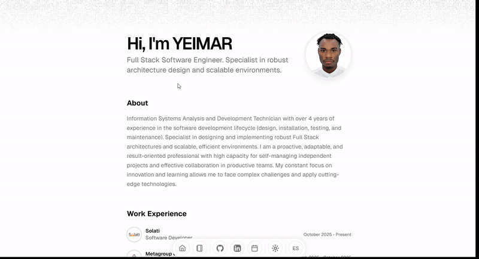

<div align="center">

</div>

# Personal Portfolio

Built with Next.js, [Shadcn/ui](https://ui.shadcn.com/), and [Magic UI](https://magicui.design/).

# Features

- **Bilingual Support**: Easily switch between English and Spanish.
- **Easy Configuration**: Edit [src/data/resume-en.tsx](./src/data/resume-en.tsx) for English and [src/data/resume-es.tsx](./src/data/resume-es.tsx) for Spanish.
- Built using Next.js 14, React, Typescript, Shadcn/UI, TailwindCSS, Framer Motion, Magic UI.
- Includes a blog.
- Responsive for different devices.
- Optimized for Next.js and Vercel.

# Getting Started Locally

1. Clone this repository to your local machine:

   ```bash
   git clone https://github.com/usyeimar/usyeimar.github.io
   ```

2. Move to the cloned directory:

   ```bash
   cd usyeimar.github.io
   ```

3. Install dependencies:

   ```bash
   pnpm install
   ```

4. Start the local Server:

   ```bash
   pnpm dev
   ```

5. Open the configuration files to customize your portfolio:
   - English: [src/data/resume-en.tsx](./src/data/resume-en.tsx)
   - Spanish: [src/data/resume-es.tsx](./src/data/resume-es.tsx)

# License

Licensed under the [MIT license](https://github.com/usyeimar/usyeimar.github.io/blob/main/LICENSE.md).
